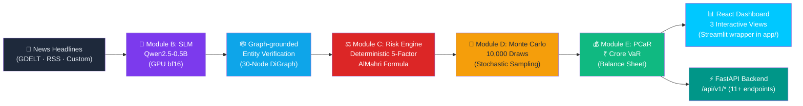

# CounterVerse — Causal AI Supply Chain Disruption Simulator

> **Scenario-based causal simulation** for Indian automotive semiconductor supply chains.  
> Headline intelligence → graph-grounded entity verification → deterministic risk scoring → Monte Carlo → Procurement Cost at Risk (PCaR).

[](https://python.org)
[](https://streamlit.io)
[](https://fastapi.tiangolo.com)
[](LICENSE)

---

## What It Does

CounterVerse transforms unstructured news headlines into **quantified financial supply chain risk estimates** for the Indian automotive semiconductor corridor:

**Gallium/Germanium (HS 8112) → Semiconductor ICs (HS 8542) → Automotive ECU Assembly → Indian OEM Vehicle Production**

It does **not** predict the future from time-series data, access proprietary OEM procurement systems, or provide audited financial statements. All cost estimates are simulated under documented assumptions.

---

## Architecture



---

## Tech Stack

| Layer | Technology | Purpose |
|---|---|---|
| **SLM Inference** | Qwen2.5-0.5B-Instruct, PyTorch bf16 | Headline → structured disruption signal |
| **Entity Grounding** | NetworkX DiGraph (30 nodes, 69 edges) | Graph-grounded entity verification |
| **Risk Scoring** | Deterministic 5-factor weighted formula | AlMahri et al. (2026) Section 3.2.5 |
| **Stochastic Engine** | NumPy Monte Carlo (10K draws) | Production drop distribution |
| **Financial Engine** | UN Comtrade HS 8542/8112 baselines | Procurement Cost at Risk (PCaR) in ₹ Crore |
| **Dashboard** | React 18 + Vite + TailwindCSS | 3-view executive decision interface (Executive War Room, Impact & PCaR, Model Governance) |
| **Iframe Wrapper** | Streamlit | Optional wrapper in `app/dashboard.py` |
| **REST API** | FastAPI + Pydantic (11+ endpoints) | Headless enterprise integration & report generation |
| **Report Generation** | Raw PDF 1.4 server-side generator | Management decision support report (`/static/reports/*.pdf`) |
| **News Ingestion** | GDELT 2.0 + RSS + SQLite cache | Resilient multi-source headline feed |
| **Persistence** | JSON + SQLite | Graph overlays & headline cache |

---

## Hardware Requirements

| Component | Minimum | Recommended |
|---|---|---|
| **GPU** | NVIDIA RTX 3050 Ti (4 GB VRAM) | RTX 4060+ (8 GB) |
| **CPU** | 4 cores | 8+ cores |
| **RAM** | 8 GB | 16 GB |
| **Disk** | 5 GB (model weights + data) | 10 GB |
| **OS** | Windows 10/11, Linux | Any with CUDA 12.x |

> **CPU-only mode:** The dashboard runs in `Fast Heuristic` mode without GPU. Only the Qwen SLM inference requires CUDA.

---

## Quickstart

Follow these steps to run CounterVerse on a clean machine:

### 1. Python Environment Setup

```bash
# Clone repository
git clone <repository-url>
cd "sem 7"

# Create and activate virtual environment (Python 3.10+ recommended)
python -m venv .venv
.venv\Scripts\activate          # Windows PowerShell / CMD
# source .venv/bin/activate     # Linux / macOS

# Install Python dependencies (CPU or CUDA)
pip install -r requirements-local.txt

# (Optional: for NVIDIA GPU CUDA acceleration)
# pip install torch torchvision torchaudio --index-url https://download.pytorch.org/whl/cu128
```

### 2. Frontend Dependencies & Build

```bash
# Install Node dependencies
npm install

# Compile TypeScript and bundle frontend assets
npm run build
```

### 3. Configure Environment Variables

```bash
# Copy example environment configuration (zero credentials required)
cp .env.example .env
```
*Note: All API keys (Comtrade, HuggingFace, Twitter) are completely optional. The platform automatically engages built-in trade baselines, NetworkX graph topologies, and offline headline feeds if keys are not provided.*

### 4. Run Automated Test Suite

```bash
# Execute test suite (130+ tests verifying Golden graph hash, RBAC, PCaR math, and PDF output)
pytest tests/ -v
```

### 5. Launch Backend & Connect Frontend

**Option A: Running Locally**
```bash
# Terminal 1 — Start FastAPI REST Backend (port 8000)
uvicorn api.main:app --host 0.0.0.0 --port 8000

# Terminal 2 — Start React/Vite Frontend (port 5173)
# (Ensure VITE_API_URL=http://localhost:8000 in your .env)
npm run dev
```
*Access the interface at `http://localhost:5173`. The War Room header will display the green **Live API** badge.*

**Option B: Running via Docker Compose**
```bash
# Orchestrates FastAPI backend and Streamlit wrapper with health checks
docker compose up --build

# Backend API:   http://localhost:8000/docs
# Web Interface: http://localhost:8501
```

### 6. Persistent State Backup & Restore

```bash
# Create timestamped archive of databases, overlays, and reports
python scripts/backup.py

# Restore platform state from latest archive
python scripts/restore.py
```

---

## API Endpoints

| Method | Endpoint | Description |
|---|---|---|
| `POST` | `/api/v1/analyze-headline` | Full pipeline: SLM → graph-grounded verification → Risk Score → Directive |
| `POST` | `/api/v1/signal` | Structured signal extraction from unstructured disruption headline |
| `POST` | `/api/v1/simulate` | Causal scoring & Monte Carlo propagation for extracted signal |
| `POST` | `/api/v1/simulate-risk` | Monte Carlo simulation with custom parameters |
| `POST` | `/api/v1/calculate-pcar` | PCaR financial metrics for predefined OEM or macro scope |
| `POST` | `/api/v1/calculate-custom-bom` | Enterprise PCaR computed from custom Bill of Materials |
| `POST` | `/api/v1/generate-report` | Server-side executive decision support report generation (raw PDF 1.4) |
| `GET`  | `/api/v1/backtest/siam` | SIAM 2021 historical benchmark backtest calibration data |
| `GET`  | `/api/v1/live-news` | Live web scraping for real-time supply chain disruptions |
| `GET`  | `/api/v1/currencies` | Supported multi-currency exchange rates (INR, USD, EUR, JPY) |
| `POST` | `/api/v1/token` | OAuth2 authentication token endpoint |
| `GET`  | `/api/v1/health` | System status, GPU availability, graph integrity, baseline vintage |

See interactive OpenAPI docs at `http://localhost:8000/docs` after launching the API.

---

## Dashboard Views (React / Vite Frontend)

| View | Component | Description |
|---|---|---|
| **01 — Executive War Room** | `ExecutiveWarRoom.tsx` | Live disruption signal ingestion, web scraper, graph entity grounding, causal propagation, stochastic drop, and CSCO directives. |
| **02 — Impact & PCaR Analysis** | `PCARView.tsx` | Enterprise Bill of Materials (BOM) upload, multi-OEM exposure allocation, multi-currency conversion, and Monte Carlo curtailment histograms. |
| **03 — Model Governance & Audit** | `GovernanceView.tsx` | 5-factor weight transparency, SIAM 2021 backtest calibration, model assumptions, and audit disclosure. |

*(Note: The repository also retains an optional Streamlit iframe wrapper in `app/dashboard.py`).*

---

## Project Structure

```
├── api/                    # FastAPI REST backend
│   └── main.py
├── app/                    # Streamlit dashboard
│   └── dashboard.py
├── src/                    # Core pipeline modules
│   ├── config.py           # Centralized settings (pydantic-settings)
│   ├── data_sources.py     # GDELT + RSS + SQLite + Comtrade data layer
│   ├── grounding_graph.py  # graph-grounded entity verification (30 nodes, 69 edges)
│   ├── module_b_slm.py     # SLM signal extractor (Qwen2.5-0.5B)
│   ├── module_c_causal.py  # Deterministic risk engine (AlMahri formula)
│   ├── module_d_mc.py      # Monte Carlo scenario engine (10K draws)
│   └── module_e_pcar.py    # PCaR financial loss engine + custom BOM
├── data/
│   ├── processed/          # Cached baselines, graph overlays, headline DB
│   ├── raw/                # Raw source data with SOURCE.md provenance
│   ├── synthesized_scenarios.json
│   └── evaluation_results.json
├── tests/                  # pytest test suites
├── scripts/                # GPU checks, evaluation harness, data fetchers
├── docs/                   # Assumptions, limitations, environment docs
├── Dockerfile
├── docker-compose.yml
└── requirements-local.txt
```

---

## Key Results (Phase 6 Post-Upgrade)

| Metric | Value | Threshold |
|---|---|---|
| **Pipeline Macro F1** | **0.933** | ≥ 0.750 ✅ |
| **Disruption Recall** | **1.000** (11/11) | = 1.000 ✅ |
| **False Alarm Specificity** | **100.0%** (4/4 rejected) | ≥ 80% ✅ |
| **SIAM 2021 Calibration Gap** | **-2.8pp** (P95 tail) | ≤ ±5.0pp ✅ |

---

## Honesty Disclaimer

- Sensitivity ±20% on CPTs is a **robustness check on assumptions**, not a confidence interval.
- PCaR numbers are **simulated under documented assumptions** using UN Comtrade macro trade volumes.
- HS 8112 is a broad tariff basket covering several metals besides gallium and germanium; its aggregate value is used only as an upstream proxy.
- Mainstream automotive MCUs are silicon-based. Gallium/germanium relevance is modeled as a stress-test pathway through compound semiconductors such as GaN, GaAs, and SiGe—not as a claim that conventional silicon MCUs are made from gallium or germanium.
- This system does **not** predict future IIP or access proprietary OEM financials.

---

## Academic Credit

**Vidyavardhini's College of Engineering & Technology, Vasai**  
Department of Computer Science & Engineering (Data Science)  
BE Final Year Mini Project — Team of 4

**Reference:** AlMahri et al. (2026), "Automating Supply Chain Disruption Monitoring via an Agentic AI Approach"
