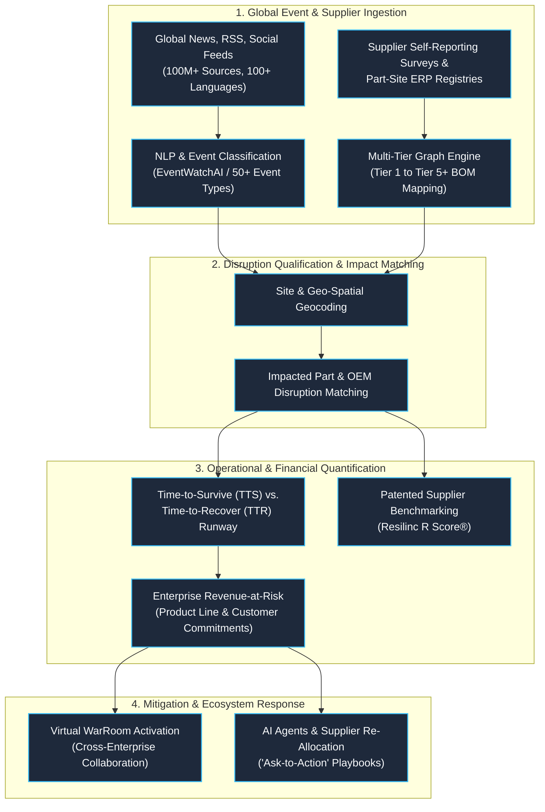

# Resilinc Functional Benchmark: Closest Commercial Analogue Analysis

**Document Version:** 1.0.0 (Audited Public Baseline)  
**Access & Verification Date:** October 18, 2026  
**Methodology Rule:** Based **strictly on official public vendor materials** (Resilinc website, official product pages, whitepapers, press releases, software tracking registries). No private code, proprietary schemas, or unverified claims are assumed or asserted.

---

## 1. Functional Capability Comparison Table

| Capability | Public Evidence (URL & Access Date) | Status | CounterVerse Equivalent | Gap / Honest Comparison |
| :--- | :--- | :--- | :--- | :--- |
| **Event / News Monitoring & Classification** | Resilinc EventWatchAI product page (`resilinc.ai/eventwatchai/`, `resilinc.com`), Oct 2026 | Publicly documented | [`src/data_sources.py`](file:///c:/Users/Dattaprasad/Videos/sem%207/src/data_sources.py), [`src/module_a_ingest.py`](file:///c:/Users/Dattaprasad/Videos/sem%207/src/module_a_ingest.py), [`GET /api/v1/headlines`](file:///c:/Users/Dattaprasad/Videos/sem%207/api/main.py) | **Scale & Breadth Gap:** Resilinc monitors 150M+ global sources across 50+ disruption categories 24/7. CounterVerse uses a lightweight, resilient 4-tier pipeline (GDELT 2.0, Google News RSS, SQLite cache, static fallback) scoped strictly to automotive semiconductors and critical metals. |
| **Multi-Tier Supplier / Site Mapping** | Resilinc Multi-Tier Mapping datasheet (`resilinc.ai/multi-tier-mapping/`), Oct 2026 | Publicly documented | [`src/grounding_graph.py`](file:///c:/Users/Dattaprasad/Videos/sem%207/src/grounding_graph.py) (Base graph: 30 nodes, 69 edges; overlay persistence) | **Data Source Gap:** Resilinc combines ERP ingest with direct, supplier-validated part-site surveys across Tier 1 through Tier 5+. CounterVerse uses a static, open NetworkX grounding graph representing India's automotive semiconductor import chain, extensible via JSON overlay. |
| **Event-to-Exposure Linking** | Resilinc EventWatch mapping & AI Agent workflows (`resilinc.ai`), Oct 2026 | Publicly documented | [`src/module_b_slm.py`](file:///c:/Users/Dattaprasad/Videos/sem%207/src/module_b_slm.py), [`ground_entities()`](file:///c:/Users/Dattaprasad/Videos/sem%207/src/grounding_graph.py), [`POST /api/v1/signal`](file:///c:/Users/Dattaprasad/Videos/sem%207/api/main.py) | **Execution Gap:** Resilinc connects alerts to exact customer part numbers and site coordinates. CounterVerse extracts structured entities (component, origin region, severity, duration) using SLM or fast heuristics and grounds them against graph nodes. |
| **Risk Scoring & Prioritization** | Resilinc R Score® patent & documentation (`resilinc.ai/r-score/`, US Patent), Oct 2026 | Publicly documented | [`src/module_c_causal.py`](file:///c:/Users/Dattaprasad/Videos/sem%207/src/module_c_causal.py) (`risk_score`, `classify_risk_band()`) | **Methodology Difference:** Resilinc's R Score® is a patented, closed supplier-benchmarking system refreshed quarterly. CounterVerse implements an open, deterministic 5-factor mathematical formula adapted from AlMahri et al. (2026) yielding an ordinal index [0.0, 1.0]. |
| **Financial / Impact Analysis** | Resilinc Revenue-at-Risk & TTR documentation (`resilinc.ai`), Oct 2026 | Publicly documented | [`src/module_e_pcar.py`](file:///c:/Users/Dattaprasad/Videos/sem%207/src/module_e_pcar.py) ($\text{PCaR}$, `extra_procurement_cost_*`) | **Metric Scope Difference:** Resilinc computes "Revenue-at-Risk" by linking part shortages to final product catalog revenues and Time-to-Survive (TTS). CounterVerse isolates **Procurement Cost-at-Risk (PCaR)** from finished vehicle loss, factoring in a stochastic spot surge multiplier ($U[1.3, 2.8]$). |
| **Alerts & Response Workflow** | Resilinc Virtual WarRooms & Collaborative Platform (`resilinc.ai`), Oct 2026 | Publicly documented | [`src/components/war-room/ExecutiveWarRoom.tsx`](file:///c:/Users/Dattaprasad/Videos/sem%207/src/components/war-room/ExecutiveWarRoom.tsx), [`src/module_i_report.py`](file:///c:/Users/Dattaprasad/Videos/sem%207/src/module_i_report.py) | **Workflow Breadth Gap:** Resilinc provisions multi-enterprise virtual WarRooms where buyers and suppliers exchange live POs and inventory confirmations. CounterVerse provides an internal executive triage dashboard and server-side PDF decision report. |
| **AI / Agentic Features** | Resilinc AI Agents ("Disruption Agent", "Ask-to-Action") (`resilinc.ai`), Oct 2026 | Publicly documented | Fast keyword extraction + optional local Qwen2.5-0.5B SLM (`src/module_b_slm.py`) | **Scale Gap:** Resilinc operates cloud-hosted multi-agent conversational bots ("Ask-to-Action") initiating supplier outreach. CounterVerse uses a small local SLM strictly for entity/signal extraction, adhering to deterministic AI safety separation. |
| **Language Coverage** | Resilinc EventWatchAI specs (100+ languages) (`resilinc.com`), Oct 2026 | Publicly documented | [`src/module_a_ingest.py`](file:///c:/Users/Dattaprasad/Videos/sem%207/src/module_a_ingest.py) (`_filter_by_language`, `langdetect`) | **Coverage Gap:** Resilinc supports global ingestion across 100+ native languages. CounterVerse has multilingual filtering capabilities configured for core trade languages (EN, ZH, JA, DE, HI). |
| **India / Regional Automotive Focus** | Resilinc Indian Operations Office in Pune (`resilinc.ai`), Oct 2026 | Publicly documented (Office presence verified; automotive part catalog depth not public) | Deep domain calibration: UN Comtrade India import baseline (₹1,33,814 Cr), SIAM FY24 market shares (Maruti, Hyundai, Tata, M&M) | **Domain Focus:** Resilinc is a global cross-industry platform (high-tech, pharma, aero, auto). CounterVerse is deeply calibrated specifically to Indian automotive OEM microcontroller import dependencies and domestic dispatch targets. |
| **Pricing & Packaging** | Software directory benchmarks (Capterra, SelectHub) starting ~$1,400/mo; Enterprise custom | Partially documented / Custom quotes | Fully open-source / Self-hosted prototype | **Commercial Gap:** Resilinc is an enterprise B2B SaaS software suite requiring annual subscription licenses and onboarding services. CounterVerse is an accessible academic research prototype. |
| **Stochastic Simulation / Monte Carlo** | Search of official Resilinc site and public documentation, Oct 2026 | **Not publicly verified** (No public evidence of Monte Carlo usage) | [`src/module_d_mc.py`](file:///c:/Users/Dattaprasad/Videos/sem%207/src/module_d_mc.py) ($N \ge 10{,}000$ Beta draws, reproducible random seed) | **Architectural Difference:** Resilinc's public documentation emphasizes deterministic operational recovery metrics (TTR vs. TTS runway). CounterVerse features explicit stochastic Monte Carlo simulation modeling production drop distributions under stress. |

---

## 2. Audit of Claims Given for Report Verification

| Claim | Verified Status | Evidence & Source (Accessed Oct 18, 2026) |
| :--- | :---: | :--- |
| **"Resilinc uses AI Agents"** | **VERIFIED** | Publicly launched specialized AI Agents (e.g., Disruption Agent, Tariffs Agent, Forced Labor Compliance Agent) with conversational "Ask-to-Action" orchestration and automated supplier outreach workflows (`resilinc.ai`). |
| **"Resilinc monitors 100+ languages"** | **VERIFIED** | EventWatchAI specifications explicitly cite scanning global news, regulatory feeds, and social sources in over 100 languages across 100+ countries (`resilinc.ai/eventwatchai/`). |
| **"Resilinc has India coverage"** | **VERIFIED** | Resilinc maintains direct corporate operations and an engineering/research office in Pune, Maharashtra, India (Manikchand Ikon, Dhole Patil Road) supporting global and regional supplier mapping (`resilinc.ai`). |
| **"Resilinc Pricing: Entry-level ~$1,400/month, Enterprise custom"** | **PARTIALLY VERIFIED** | Entry-level commercial tier tracking on software directories (Capterra, SelectHub) cites starting tiers around ~$1,400/month; full enterprise multi-tier mapping is private custom-quote based on supplier network scale and ERP integrations. |
| **"Resilinc uses Monte Carlo simulation"** | **NOT VERIFIED (ABSENT)** | A search across official public Resilinc documentation yielded **zero** citations or references to Monte Carlo simulation. Resilinc public literature focuses on empirical deterministic parameters: Time-to-Recover (TTR), Time-to-Survive (TTS), and site-level Revenue-at-Risk. |

---

## 3. Where CounterVerse is Deliberately Different

CounterVerse does not claim to be "better" or a commercial competitor to enterprise platforms like Resilinc. Rather, CounterVerse was engineered around specific, transparent **academic and decision-support design choices**:

1. **Narrow Scope vs. General Catalog:**  
   Instead of tracking thousands of global commodities, CounterVerse concentrates exclusively on the **HS 8542 (electronic integrated circuits) $\rightarrow$ HS 8112 (gallium/germanium raw materials) $\rightarrow$ automotive ECU $\rightarrow$ Indian OEM assembly** chain. This enables deep domain calibration to SIAM FY24 domestic volumes and UN Comtrade trade flows.

2. **Open, Audit-Transparent Formulas vs. Patented Black-Box Scoring:**  
   Resilinc’s R Score® is a patented, proprietary composite benchmark. CounterVerse explicitly avoids black-box scoring: its 5-factor deterministic risk score formula (AlMahri et al., 2026) and additive procurement premium formula ($M_i \sim \text{Uniform}[1.3, 2.8]$) are published, inspectable, and reproducible by external auditors.

3. **Deterministic AI Safety Separation:**  
   In CounterVerse, language models (SLM or fast heuristics) are strictly restricted to linguistic signal parsing (entity extraction, severity, duration). No causal probabilities, risk scores, or financial losses are calculated by an LLM, guaranteeing deterministic mathematical reproducibility.

4. **Stochastic Stress Testing with Reproducible Seeds:**  
   While commercial tools primarily track operational lead times (TTR), CounterVerse provides quantitative scenario simulation using Beta-distributed Monte Carlo draws with explicit random seed controls (`random_seed: int`), enabling academic stress-testing of supply chain tail risks (P95 and P99 VaR).

---

## 4. Typical Commercial Product-Category Conceptual Architecture

*The diagram below illustrates a typical product-category conceptual workflow for enterprise supply-chain risk platforms (such as Resilinc), contrasted with CounterVerse's simulation boundary. It is labeled as a generalized product-category model, not Resilinc's proprietary internal architecture.*

---

## 5. Defensible Wording for External Viva & Report

The following wording is recommended for viva defense and technical project reports:

> *"In the commercial supply chain risk management (SCRM) domain, platforms such as Resilinc serve as the closest commercial analogue to CounterVerse. Public vendor documentation indicates that Resilinc provides multi-tier part-site mapping, 24/7 global event monitoring across 100+ languages (EventWatchAI), patented supplier benchmarking (R Score®), and operational metrics like Time-to-Recover (TTR) and Revenue-at-Risk. Whereas enterprise commercial suites operate continuous, multi-industry supplier survey networks and automated partner playbooks, CounterVerse is a lightweight, academic decision-support prototype deliberately narrowed to the Indian automotive semiconductor import corridor (HS 8542). CounterVerse emphasizes transparent, inspectable mathematical formulations (adapted from AlMahri et al., 2026), open UN Comtrade macro baselines, and stochastic Monte Carlo scenario simulation with reproducible seeds, functioning as an exploratory stress-testing engine rather than an enterprise vendor replacement."*
